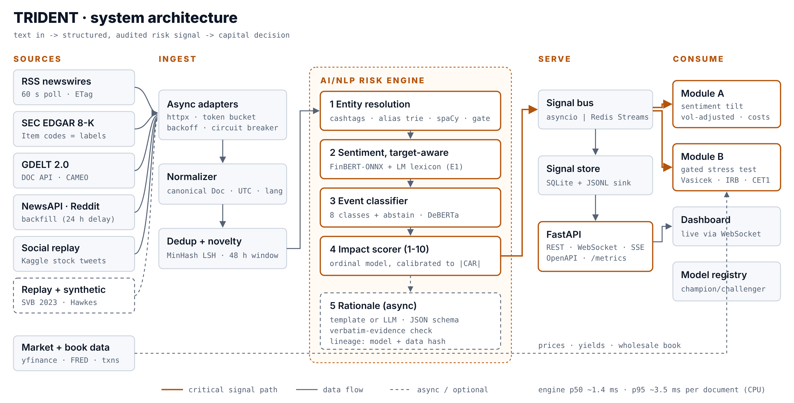
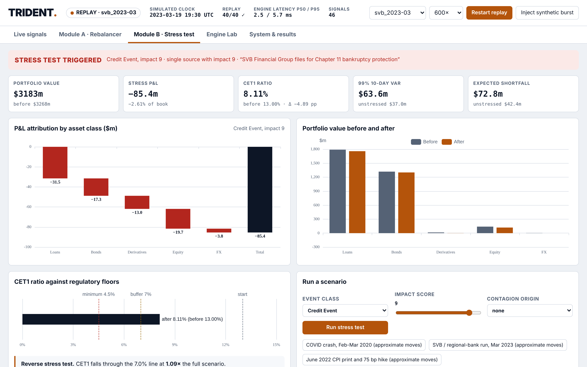

# TRIDENT: Real-Time AI/NLP Risk Engine - S&P Global & Crisil Campus Hackathon

**Candidate Name:** [Your Full Name]
**College Email ID:** [roll-no]@smail.iitm.ac.in
**College / Campus:** Indian Institute of Technology Madras
**Demo Video Link:** [YouTube, unlisted - paste link]
**Slide Deck Link (if hosted externally):** [docs/presentation.pdf](docs/presentation.pdf)

> One engine · two strategies · three signals. Text in, capital decision out, every step auditable.

## 1. Project Overview / Problem Statement & Approach

Market-moving information arrives as unstructured text (newswires, regulatory filings, social posts) long before it reaches structured data. In March 2023 a bank run spread through social media and news within hours; risk teams that read structured feeds learned last. The case study asks for an AI/NLP engine that turns such text into machine-readable risk signals, plus at least one downstream module that acts on them.

TRIDENT ingests news, SEC filings, GDELT and social posts, resolves each item to a company, a sector or the whole market, and emits a structured signal with the three required fields: **sentiment** (−1 to +1, target-aware), **event class** (8 classes plus an abstain class, with credit subtypes in rating-surveillance language) and **impact** (1-10, an ordinal model calibrated against realized absolute abnormal returns). Every signal carries its evidence spans, a rationale, the model versions and a data hash, so a model-risk reviewer can trace any number to a phrase in the source.

Both downstream modules are built. **Module A** tilts a 15-stock S&P 100 index toward positive sentiment with a volatility-adjusted multiplicative tilt, hard caps, a no-trade band, a turnover cap and transaction costs; parameters are chosen walk-forward. **Module B** stress-tests a synthetic ~$3.3bn wholesale banking book (corporate loans, bonds, swaps, CDS, index options, FX) when a high-impact Geopolitical, Macroeconomic or Credit event is confirmed by two independent sources. It reprices with Vasicek PD migration, duration-convexity, Greeks and full Black-Scholes, and reports P&L, stressed VaR/ES and the change in **CET1 ratio** under Basel IRB capital, plus a reverse stress test.

## 2. Architecture & Tech Stack



- **Ingestion:** async adapters (RSS with conditional GET, SEC EDGAR 8-K, GDELT DOC 2.0, NewsAPI backfill, Reddit, tweet replay) with token-bucket rate limits, backoff and a circuit breaker per source; deterministic **replay** of historical windows for a network-free demo.
- **Pipeline:** normalization and language filter → MinHash-LSH near-duplicate clustering (48 h window; cross-source repeats count as confirmations) → novelty and burst velocity.
- **Engine:** (1) entity resolution: cashtags, exchange tags, alias trie, ambiguity gate (Apple vs apple), optional spaCy ORG check, fuzzy fallback; (2) sentiment: finance lexicon with Loughran-McDonald words, negation and delta phrases, blended with FinBERT / ONNX-INT8 when installed (eq. E1), target-dependent per entity; (3) events: keyword rules + trained model hybrid, abstain below confidence 0.45; (4) impact: ordinal (proportional-odds) model; (5) rationale: template or schema-locked LLM with a verbatim-evidence check.
- **Serving:** FastAPI (REST, WebSocket, SSE, OpenAPI, `/metrics`), SQLite store + JSONL sink, pluggable bus (in-process or Redis Streams).
- **Modules:** NumPy/SciPy; cvxpy mean-variance optimizer with Ledoit-Wolf covariance (Module A edge tier).
- **Dashboard:** static HTML + ECharts (vendored, works offline), served by FastAPI.
- **MLOps:** champion/challenger model registry, behavioral (CheckList-style) tests, adversarial validation of synthetic data, PSI drift monitor, 55 pytest tests including Hypothesis property tests.
- **Key libraries:** FastAPI, Pydantic v2, httpx, scikit-learn, SciPy, cvxpy, transformers + onnxruntime (optional), spaCy (optional), ECharts.

## 3. Dataset Used

- **Public, fetched by `scripts/fetch_data.py`:** Financial PhraseBank, zeroshot twitter-financial-news sentiment and topic, GDELT 2.0, RSS newswires, SEC EDGAR 8-K, NewsAPI (backfill), Kaggle stock news and stock tweets, Kaggle Financial Transactions, yfinance prices, FRED yields and spreads.
- **Shipped in `data/`:** reconstructed SVB-2023 and COVID-2020 replay timelines (public events paraphrased; synthetic posts tagged), an authored fictional gold set of 180 headlines, synthetic training text, a synthetic known-answer market, and a wholesale book derived from transaction data.
- **Assumptions and full provenance:** [data/README.md](data/README.md). No proprietary or confidential data; no S&P Global or Crisil client information.

## 4. Quickstart & Installation

Runtime: Python 3.11-3.13 on Ubuntu 22.04/24.04, macOS 14 and Windows 11.

```bash
git clone <your-repo-url>
cd iitm-<your-name>-hackathon
pip install -r requirements.txt
pip install -e . --no-deps        # makes the `trident` package importable (all OSes)
python -m trident demo            # SVB replay, no API keys, no network -> http://localhost:8000
```

| Command | What it does |
|---|---|
| `python -m trident demo --replay covid_2020-03` | replay the COVID crash instead |
| `python -m trident serve --live` | live RSS, EDGAR, GDELT, NewsAPI (`NEWSAPI_KEY`), Reddit |
| `python -m trident analyze "JPMorgan downgraded two notches"` | one-off signal as JSON |
| `python -m trident stress --event "Credit Event" --impact 9` | one stress run in the terminal |
| `python -m pytest` | 55 unit, property, behavioral and API tests |
| `python scripts/run_all_results.py` | regenerate every number and figure in the deck |
| `docker compose up` | same demo in a container |

Full walkthrough, including fine-tuning FinBERT/DeBERTa, real-data evaluation and the submission checklist: [docs/SETUP_GUIDE.md](docs/SETUP_GUIDE.md).

## 5. Key Results & Domain Impact

All numbers come from `python scripts/run_all_results.py` ([docs/results/RESULTS.md](docs/results/RESULTS.md)); each is labeled with the data it used.

| Area | Result | Data |
|---|---|---|
| Engine latency | **p50 1.4 ms, p95 3.3 ms** per document; ~850 docs/s on one CPU process | measured |
| Sentiment | macro-F1 **0.65 vs VADER 0.47**; hard cases (negation, sarcasm, delta phrases) 64% vs 29% | authored set (optimistic); replace with PhraseBank/real labels |
| Entities | precision **1.00**, recall 0.98, 3/3 ambiguity traps | authored set |
| Behavioral tests | **58/58** (negation, entity swap invariance, intensity, disambiguation) | generated cases |
| Impact score | Spearman vs realized \|CAR\| **0.20 out of sample**; 0.23 ± 0.08 over 5 seeds | synthetic known-answer market |
| Module A | walk-forward out-of-sample **net IR 0.95** (gross 1.23); over 5 seeds net IR 0.29 ± 0.62 | synthetic known-answer market |
| Module B | Credit Event I=9: P&L **−$80m**, CET1 **13.0% → 8.4%**, 99% 10-day VaR $37m → $64m; reverse stress breaches the 7% line at 1.09× | synthetic book |
| SVB replay | first headline **held** by the two-source gate; stress test **triggered 25 minutes later** on independent confirmation | reconstructed timeline |
| Honest negatives | template synthetic text is easy to detect (adversarial AUC 0.95), and models trained on it were **rejected** by the champion/challenger registry | measured |

**Why it matters.** For credit surveillance, TRIDENT flags obligors within minutes of adverse news, ranked by a calibrated impact score and with the evidence attached. For portfolio managers it is a disciplined, cost-aware tilt rather than a headline-chasing strategy. For risk and treasury it turns a headline into the number a risk committee reads: the CET1 ratio after the shock, and how much worse it would have to get to breach the buffer.


